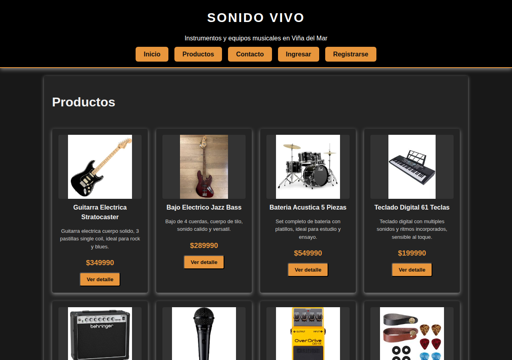

# Sonido Vivo

Sitio web para una tienda de instrumentos y equipos musicales de Viña del Mar.

**Evaluación 2 — Desarrollo FullStack II:** migración a **React** del sitio de la primera entrega
(HTML + CSS + JS), manteniendo el mismo diseño.

**Integrantes:** Bastian Alarcón e Ignacio Hidalgo.



## Cómo ejecutarlo

Requisitos: Node.js 22.13 o superior (las pruebas con Vitest 5 no funcionan en Node 20).

```bash
npm install      # instala las dependencias (solo la primera vez)
npm run dev      # levanta el sitio en http://localhost:5173
```

Otros comandos:

```bash
npm test         # pruebas unitarias con Vitest (modo observador)
npx vitest run   # pruebas, una sola ejecución
npm run lint     # revisión de código con ESLint
npm run build    # versión de producción en la carpeta dist/
```

### Cuentas de prueba (credenciales estáticas)

El login compara contra cuentas fijas definidas en `src/data/usuarios.js` (no hay servidor):

| Rol | Correo | Contraseña | Puede entrar a |
| :--- | :--- | :--- | :--- |
| Administrador | `admin@duoc.cl` | `admin123` | Mi Perfil y Panel de Control |
| Cliente | `cliente@gmail.com` | `cliente123` | Mi Perfil |

## Tecnologías

- React 19 + Vite
- react-router-dom (rutas)
- React Bootstrap (solo en formularios, filtros, alertas y la tabla del Panel)
- Vitest + React Testing Library (pruebas)
- CSS original de la primera entrega (`src/App.css`)

## Páginas y rutas

| Página | Ruta | Acceso |
| :--- | :--- | :--- |
| Inicio | `/` | Pública |
| Productos (catálogo) | `/productos` | Pública |
| Producto (detalle) | `/productos/:id` | Pública |
| Contacto | `/contacto` | Pública |
| Login | `/login` | Pública |
| Registro | `/registro` | Pública |
| Carrito de compras (resumen y pago) | `/carrito` | Pública |
| Mi Perfil | `/perfil` | Privada (con sesión) |
| Panel de Control | `/admin` | Privada (solo administrador) |
| Error 404 | cualquier otra ruta | Pública |

## Estructura (Atomic Design)

```
src/
├── components/
│   ├── atoms/        Piezas mínimas: Boton, Precio, ImagenProducto, BotonFavorito, BotonTema...
│   ├── molecules/    Combinaciones: TarjetaProducto, CampoFormulario, BarraFiltros, FilaCarrito...
│   └── organisms/    Secciones completas: Header, MenuPrincipal, DetalleProducto, formularios, tablas...
├── pages/            Una página por ruta (Home, Productos, Producto, Login, Registro, Admin, Carrito, Perfil, NoEncontrado, Contacto)
├── routes/           RutaPrivada (protección con localStorage)
├── data/             Productos, textos, menú, opciones de listas, campos de formularios y cuentas de prueba
├── utils/            Lógica sin interfaz: validaciones, carrito, productos, sesión y formato de precios
├── img/              Imágenes de los productos
├── App.jsx           Estados compartidos y rutas
└── App.css           Estilos originales + ajustes
```

## Funcionalidades con estado (useState)

1. **Carrito de compras:** agregar, cambiar cantidad, eliminar, vaciar, total y checkout simulado.
2. **Filtro dinámico del catálogo:** por nombre/marca y por categoría.
3. **Favoritos:** se marcan en las tarjetas y en el detalle, y se listan en Mi Perfil.
4. **Tema claro / oscuro:** botón en el menú (el oscuro es el diseño original).
5. **Menú ☰ en celulares:** se abre y se cierra.
6. **Subtotal en el detalle de producto** (igual que la primera entrega).
7. **Panel de Control (CRUD en memoria):** crear, editar y eliminar productos. Los nuevos usan una imagen genérica y se pierden al recargar la página.
8. **Sesión:** login con credenciales estáticas guardado en `localStorage`.

## Elementos responsivos

1. Menú principal: en pantallas de menos de 600 px se convierte en un botón ☰ que despliega la lista.
2. Grilla de productos: las tarjetas se acomodan solas y en celular ocupan todo el ancho.
3. Detalle de producto: imagen e información lado a lado en escritorio, una debajo de la otra en celular.
4. Carrito: la fila de cada producto pasa a dos columnas en tablet/celular y el formulario de pago baja debajo del resumen.
5. Panel de Control: la tabla de React Bootstrap es `responsive` (se desplaza dentro de su caja en celular).
6. Formularios y Mi Perfil: pasan a una sola columna a todo el ancho.

## Validaciones y campos de contexto

Se mantienen todas las validaciones de la primera entrega (correo con dominio `duoc.cl`, `profesor.duoc.cl`
o `gmail.com`, largo de contraseña de 4 a 10, RUN, largos máximos, contraseñas iguales...). La fecha de
nacimiento (opcional) no puede ser posterior a hoy y la persona debe tener entre 13 y 120 años. Cada formulario
muestra el primer error debajo del campo y deja el cursor en él.

Campos de contexto de una tienda de música agregados:

- **Registro:** teléfono, comuna, instrumento principal y nivel musical.
- **Contacto:** motivo de contacto e instrumento de interés.
- **Panel de Control:** marca, categoría, precio y stock del producto.
- **Checkout:** tipo de entrega (retiro en tienda o despacho), comuna, dirección y medio de pago.

## Pruebas

40 pruebas unitarias con Vitest, todas con el patrón AAA. El detalle está en
[`plan_de_pruebas.md`](plan_de_pruebas.md).
